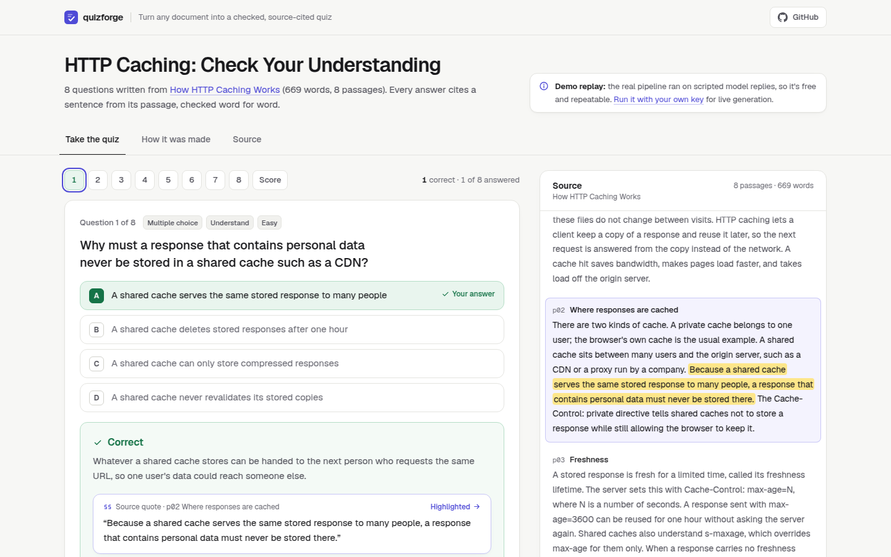
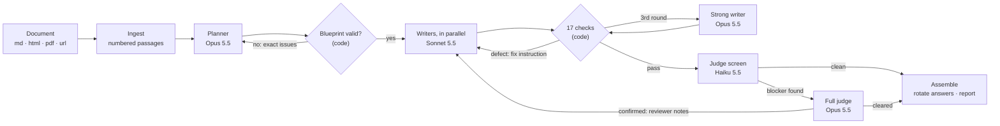

# quizforge

**Turn any document into a quiz where every answer is checked against the source and cited.** A multi-agent pipeline in TypeScript on Claude and Mastra: a planner, parallel writers, 17 deterministic checks and a two-tier judge that send weak questions back until they are right.



**Live demo:** _coming soon_ · **Run it free:** `npm install && npm run demo`

[](https://github.com/saqlain-489/quizforge/actions/workflows/ci.yml)

## Why

Language models write quiz questions quickly and fail in predictable ways. The right answer is the longest option. Two options are both defensible. The "source" is a paraphrase of something the document never said. quizforge treats writing as the cheap part and spends its effort on catching those failures: in code wherever a rule can decide, with a model only where judgment is needed, and with every rejection fed back to the writer as an exact instruction.

## How it works



1. **Ingest** splits Markdown, HTML, PDF or a URL into numbered passages under their headings, so every question can name the one passage it is answered from.
2. **Plan.** The planner returns a blueprint: type, passage, skill, difficulty and focus per question. Code checks coverage, type mix, repeated focuses and passage ids, and returns problems as instructions. A plan still wrong after two tries is repaired in code, not thrown away.
3. **Write and check.** Writers draft items in parallel. Each draft runs through 17 deterministic checks (the quote must appear in the passage word for word, the key must not be the visibly longest option, one blank per sentence, no answer in the stem…). A failed draft goes back with the checker's exact words. The third attempt goes to the stronger model.
4. **Judge.** A cheap model grades every item on five dimensions in one call. Only when it finds something does the strong model look. A confirmed blocker sends the item back for one rewrite with the reviewer's notes; an item that fails review twice is dropped and reported.
5. **Assemble.** Correct options are rotated to a slot derived from the question text, and the run report records every retry, escalation, drop, token and dollar.

## Decisions worth a look

- **Retries carry the checker's exact words.** "Try again" fixes little. "The correct option is 3.4x as long as the wrong ones. Rewrite the three wrong options to the same length; do not shorten the right one" fixes it on the next round. See [`src/write.ts`](src/write.ts) and [`src/checks`](src/checks/index.ts).
- **Model routing by need, not by habit.** Sonnet writes; Opus sees only the third attempt. Haiku screens every item; Opus reads only what Haiku flagged. The judge that escalates is never the model that wrote the item. Chains per role, with fallback on rate limits and outages, live in [`src/models.ts`](src/models.ts).
- **A judge must quote its evidence.** An issue without a verbatim quote from the item or the passage is dropped and the score lifted to the threshold. It is the cheapest defence against a judge inventing problems, and it keeps every reported issue checkable by a person.
- **"Could not judge" is never a pass.** A timeout, an unreadable reply or a missing key records `not_run`. It never counts toward a passing score.
- **Refuse versus warn.** On the last round, defects that make an item wrong or unanswerable drop it. Milder ones ship with a warning, because a slightly long option beats a missing question.
- **The document is cached once per run.** It is sent first with cache control, and the first item runs alone so the cache exists before the parallel writers start.
- **Refusals are handled, not crashed on.** Server-side fallback re-runs a declined request on the model's default fallback. If the reply is still a refusal, the writer gets "reword neutrally" instead of the same prompt again.
- **Replay as a first-class model.** The `replay` adapter answers from a script, keyed per role and item. The tests, the benchmark and the public demo all run the real pipeline for free and give the same result every time.

## Evals and tests

| What | Result | Run it |
|---|---|---|
| Checker benchmark: 31 cases, including 9 clean items and near misses | precision 100%, recall 100%, every detector exercised | `npm run evals` |
| Unit and integration tests: every agent path with a scripted model; the live Anthropic adapter against a fake network (request shape, prompt caching, fallback on overload, refusals); the Mastra workflow; the MCP server over stdio | 29 passing | `npm test` |

CI runs both on every push with no API key and no spend. Not measured yet: the judge's agreement with human reviewers (see Limitations).

## Quick start

```bash
npm install
npm run demo        # replays the bundled example: the full pipeline, no key, no cost
npm test            # tests + checker benchmark
```

Live generation needs an Anthropic API key in your environment (`ANTHROPIC_API_KEY`):

```bash
npm run generate -- path/to/notes.pdf --count 10 --types mcq,true_false,fill_blank
npm run generate -- https://example.com/article --out runs
```

Each run writes `runs/<name>.quiz.json` (the quiz, the source passages and the full run report) and a readable `runs/<name>.quiz.md` with an answer key. After editing a saved quiz by hand, re-check it with `npm run check -- runs/<name>.quiz.json`.

### Use it from Claude Code (MCP)

```bash
claude mcp add quizforge -- node /path/to/quizforge/bin/mcp.mjs
```

Tools: `check_quiz_item` (free deterministic checks for any item you write), `list_checks`, and `generate_quiz` (the full pipeline; uses your key).

### Models

| Role | Default chain | Effort |
|---|---|---|
| planner | claude-opus-5-5 → claude-sonnet-5-5 | medium |
| writer | claude-sonnet-5-5 → claude-opus-5-5 | medium |
| writer (final round) | claude-opus-5-5 → claude-sonnet-5-5 | high |
| judge screen | claude-haiku-5-5 → claude-sonnet-5-5 | low |
| judge full | claude-opus-5-5 → claude-sonnet-5-5 | medium |

Override any chain with `QUIZFORGE_MODELS_<ROLE>`, e.g. `QUIZFORGE_MODELS_WRITER=claude-opus-5-5`.

## Layout

```
src/ingest.ts       documents → numbered passages (md, html, pdf, url)
src/plan.ts         planner agent, blueprint validation and repair
src/write.ts        writer loop: draft → check → exact feedback → stronger model
src/checks/         17 deterministic detectors, each with a fix instruction
src/judge.ts        screen → escalate judge, evidence rule, not_run semantics
src/assemble.ts     deterministic, idempotent answer-position rotation
src/pipeline.ts     per-item lanes, run report
src/workflow.ts     the same stages as a Mastra workflow
src/mcp/server.ts   MCP server (Mastra)
src/llm/            Anthropic adapter (structured outputs, caching, fallback) and the replay adapter
prompts/            one YAML system prompt per role; a missing prompt stops the boot
evals/              checker benchmark and gate
web/                the demo viewer (Next.js, static export)
```

## Limitations

- The judge's agreement with human reviewers is not measured yet. Next step: a labelled set of 100 items and a calibration report.
- One document per quiz; no questions that join two documents.
- PDF text extraction loses tables and multi-column layout.
- The live demo is a replay. Live generation needs your own key.

## License

MIT © 2026 Saqlain Ahmad
